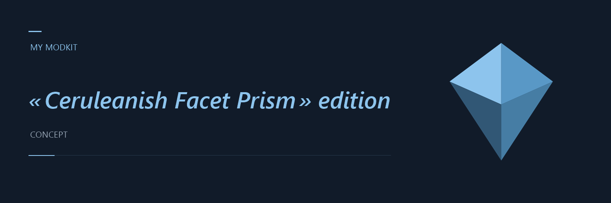

# version-banner-generator



Minimal release banners made from your own transparent renders: a dark background,
palette-coloured italic edition title, matched quotation marks and a character image.
Includes one-command PNG export, future-concept batches and a resolved JSON recipe.

**Current scope:** a Windows PowerShell/System.Drawing compositor for existing
PNG renders. No extra packages, network calls, AI generation or original modkit
installation required. This repository does not yet include a model renderer or
game adapter. The default demo is an original geometric prism.

## Give this to your coding bot

[BOT-BRIEF.md](BOT-BRIEF.md) explains how to adapt the idea to a modding project,
including verified head selections, camera presets and selective recolouring.
It distinguishes the working compositor from future adapter integration.

## Generate a banner

Run from the repository root on Windows:

```powershell
powershell -NoProfile -File tools/make-banner.ps1
```

This writes `build/release-banner.png` and `build/release-banner.json`.
Existing images or recipes are never silently overwritten. Use `-Out` for a new path.

```powershell
powershell -NoProfile -File tools/make-banner.ps1 -Project 'MY GAME MODKIT' -Name 'Jadeish Crown Raven' -Version 'v0.2.0' -Palette green -QuoteStyle french -ImagePath private/raven-head.png -Out build/raven-v0.2.png
powershell -NoProfile -File tools/make-banner.ps1 -Batch -Out build/future-concepts
```

| Option | Meaning |
| --- | --- |
| `-Project` | Small project label |
| `-Name` | Release name; quotation marks and `edition` are added automatically |
| `-Version` | Secondary text; default `CONCEPT` |
| `-Palette` | `blue`, `orange`, or `green` text/accent palette |
| `-QuoteStyle` | `random` (default), `english`, `french`, `spanish`, `german`, or `japanese` |
| `-ImagePath` | Local transparent PNG; defaults to the included original prism |
| `-Out` | PNG path, or batch output directory |
| `-Batch` | Three palette/name concepts labelled `FUTURE CONCEPT`; uses the selected image |

Names and versions are plain text. Batch mode uses its example names rather than
`-Name` or `-Version`. Palettes change text and accents, not image pixels. Random
quote styles are recorded independently per output. Layout is fixed at 1500 x 500;
long titles shrink to fit. Very long project/release names are rejected.

For the same typography across machines, use the same Windows fonts. Each recipe
records the selected quote style, caption, palette, font, dimensions and input
image SHA256. It contains only the input basename, not a private absolute path.
To reproduce a banner, supply the recorded values and the same image/font setup;
automatic recipe replay is not implemented yet.

## Connect your game

The compositor consumes a transparent PNG. A separate game adapter should render
verified geometry with saved camera settings and perform material/part recolours
before calling it. See [the adapter contract](docs/ADAPTERS.md). You can start with
a cached render without pretending that arbitrary model rendering is automated.

Keep private assets in `private/` or outside this repository. ROMs, extracted
models, textures, private indexes and game-derived renders are not included.
The software licence does not grant rights to game imagery.

## Check it

```powershell
powershell -NoProfile -File tools/smoke-test.ps1
```

The checks generate all quote styles and a batch, inspect PNG dimensions and JSON
recipes, and confirm overwrite refusal. Visual checks remain separate. The original
demo can be recreated with `examples/make-demo.ps1` when its PNG is absent.

Original code, documentation and synthetic demo are dedicated under
[CC0 1.0 Universal](LICENSE). Third-party inputs retain their own terms.
